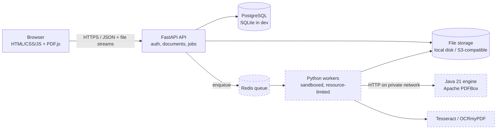

# PDF Master Pro — Architecture and Plan

This document is the planning deliverable required before implementation (architecture, structure,
database, API, roadmap, dependencies). Phase 1 is implemented and tested; later phases are designed
here but **not built yet** — see `CHECKLIST.md` for the exact state.

## A. Architecture



Dashed components arrive in Phases 2–4. Phase 1 runs as one API process plus a database.

**Principles**

- **The browser renders, the server edits.** PDF.js draws pages. Every change to a PDF is performed
  server-side on the real file, never by painting over a screenshot.
- **Untrusted input.** Uploaded PDFs are parsed only in short-lived subprocesses with CPU, memory and
  time limits (`backend/app/workers/`). The API process itself never parses a PDF.
- **Per-user isolation.** Every document query is filtered by `user_id`; files live under
  `storage/uploads/<user_id>/<random>.pdf`; user-supplied names never become paths.
- **Honest capability reporting.** Features are listed as available only after automated tests pass.

### How real text editing will work (Phase 2 — the hard part)

A PDF does not store paragraphs. It stores drawing instructions: "select font F1, move to x,y, paint
these glyph codes". Editing existing text therefore means rewriting those instructions, and what is
possible depends on the kind of content:

| Content type | Detection | Editing approach |
|---|---|---|
| Native text, font fully embedded or a standard font | text operators present; font program covers needed glyphs | Rewrite the text-showing operators in the page content stream (PDFBox `PDFStreamParser` → modify `Tj`/`TJ` → write back). Vector graphics and images are untouched. |
| Native text, **subset** font missing the new glyphs | font subset lacks required characters | Remove the original operators and re-set the run in a metrically similar substitute font, embedded. The user is told a substitution happened. |
| Scanned page (text is pixels) | page is covered by an image and has no text operators | OCR to locate words; user edits are applied by removing the image region (inpainting the background) and setting new text. Clearly labelled as reconstruction, not native editing. |
| Text converted to outlines | paths without text operators | Not editable as text. Offered: OCR-based reconstruction or overlay. |
| Flattened forms/annotations | appearance streams merged into page | Treated as native text or outlines depending on what the stream contains. |

No tool, including commercial ones, edits every PDF perfectly; reflowing a paragraph across lines is
approximate everywhere because the file holds no paragraph structure. The UI will state which of the
four categories a selected block falls into.

Redaction (Phase 4) uses the same content-stream machinery: the selected operators and image pixels
are removed from the file, then the result is re-scanned to prove the text is no longer extractable.

### Why two languages

Python (FastAPI) owns the API, auth, jobs and orchestration. Java is used only where PDFBox is
clearly stronger than the permissively licensed Python options: content-stream rewriting, font
handling, certificate signatures, PDF/A. It runs as a private HTTP service that receives a storage
path and an operation list — it is never exposed to the internet.

## B. Folder structure

```
pdf-master-pro/
├── backend/
│   ├── app/
│   │   ├── main.py            app factory, middleware, housekeeping loop
│   │   ├── config.py          settings from environment (.env)
│   │   ├── database.py        engine / session
│   │   ├── errors.py          single error envelope
│   │   ├── models/            SQLAlchemy models (all tables)
│   │   ├── schemas/           Pydantic request/response models
│   │   ├── routers/           auth, documents, editor (+ pages, convert, … later)
│   │   ├── services/          storage, pdf_inspect, audit
│   │   ├── security/          passwords (Argon2id), tokens, deps, rate_limit, headers
│   │   └── workers/           isolated PDF subprocess workers
│   ├── alembic/               migrations
│   ├── requirements.txt, requirements-dev.txt, Dockerfile
├── frontend/                  static site (index, dashboard, editor) + vendored PDF.js/Bootstrap
├── java-engine/               (Phase 2) Maven project, PDFBox service
├── tests/backend, tests/frontend, tests/integration
├── samples/                   generated, freely distributable test PDFs
├── storage/                   uploads / processed / temp (git-ignored)
├── docs/                      this file, CHECKLIST.md, verification reports
├── docker-compose.yml, .env.example, setup_windows.bat, start_pdf_master.bat
└── .github/workflows/ci.yml
```

## C. Database

Implemented in `backend/app/models/__init__.py`, migration `0001`. Primary keys are random UUIDs
(strings) so identifiers are not guessable or enumerable.

| Table | Purpose | Notes |
|---|---|---|
| `users` | accounts | `password_hash` is Argon2id; `email` unique, stored lower-case; `role` = `user` \| `admin` |
| `documents` | one row per uploaded PDF | `page_count` is NULL while the file is password-protected; `storage_path` relative to storage root |
| `document_versions` | every saved state | v1 = original upload; powers undo across sessions and "restore" |
| `processing_jobs` | long-running work | status / progress / error, polled by the UI (used from Phase 3) |
| `user_settings` | theme, default OCR language, default compression | created with the user |
| `audit_logs` | who did what, from where | `document_id` intentionally has no FK so entries survive deletion |
| `refresh_tokens` | *(addition to the spec)* | SHA-256 of each refresh token, so sessions can be revoked and rotated |

Neither account passwords nor PDF passwords are stored. A PDF password is used in memory for the one
operation that needs it.

## D. API

Live, generated documentation: `/api/docs` (OpenAPI at `/api/openapi.json`).
Errors always look like `{"error": {"code": "...", "message": "...", "details": [...]}}`.

| Area | Endpoint | Phase | Status |
|---|---|---|---|
| Auth | `POST /api/auth/register`, `login`, `logout`, `refresh`; `GET /api/auth/me` | 1 | done |
| Documents | `POST /api/documents/upload`; `GET /api/documents`; `GET/DELETE /api/documents/{id}`; `GET /api/documents/{id}/download` | 1 | done |
| Viewer | `GET /api/editor/{id}/metadata`, `GET /api/editor/{id}/pages` | 1 | done |
| System | `GET /api/health` | 1 | done |
| Editor | `POST/PUT/DELETE /api/editor/{id}/text…`, `POST …/images`, `POST …/annotations`, `POST …/save` | 2 | planned |
| Pages | `POST /api/pages/add · delete · reorder · rotate · extract` | 2 | planned |
| Tools | `POST /api/merge`, `/api/split`, `/api/compress`, `/api/convert/*` | 3 | planned |
| Security | `POST /api/security/protect`, `/unlock`; `GET /api/security/inspect` | 3 | planned |
| Jobs | `GET /api/jobs/{id}`, `GET /api/jobs/{id}/download` | 3 | planned |
| OCR | `POST /api/ocr/process`, `GET /api/ocr/status/{job_id}` | 4 | planned |

**Session design.** Access token: JWT (HS256), 15 minutes, sent as `Authorization: Bearer`. Refresh
token: opaque random value in an `HttpOnly` cookie scoped to `/api/auth`, rotated on every use;
re-use of an old token revokes all of that user's sessions. Cookie-authenticated endpoints require
an `X-Requested-With` header (CSRF defence), and CORS only admits allow-listed origins.

## E. Roadmap

| Phase | Scope | Exit criteria |
|---|---|---|
| 1 Foundation | structure, DB, auth, dashboard, upload/download, viewer | **Complete** — see `VERIFICATION_PHASE1.md` |
| 2 Core editing | Java engine; text/image editing; page management; annotations; undo/redo; versions | integration test: edit text → save → reopen → extracted text and rendering match |
| 3 Tools | Redis queue + workers; merge, split, compression, conversions, protect/unlock with credentials | each tool round-trips sample files; job polling works; interrupted jobs recover |
| 4 Advanced | OCR (eng + hin), certificate signatures, true redaction, metadata, repair, batch, forms | redaction test proves text is unrecoverable; signature validates in a third-party reader |
| 5 Quality | load tests, fuzzing with malformed PDFs, container sandboxing, browser matrix, admin dashboard | security checklist signed off |
| 6 Deployment | S3 storage, production compose, deploy workflow, operations guide | clean deploy on a fresh VPS from the README alone |

## F. Dependencies and licences

In use now (Phase 1):

| Package | Licence | Use |
|---|---|---|
| FastAPI, Starlette, Uvicorn | MIT / BSD-3 | API |
| Pydantic, pydantic-settings | MIT | validation, settings |
| SQLAlchemy, Alembic | MIT | ORM, migrations |
| psycopg 3 | LGPL-3.0 | PostgreSQL driver (used unmodified as a library) |
| argon2-cffi | MIT | Argon2id hashing |
| PyJWT | MIT | access tokens |
| python-multipart | Apache-2.0 | uploads |
| pypdf | BSD-3 | structure inspection |
| cryptography | Apache-2.0 / BSD | AES for encrypted PDFs |
| PDF.js (vendored 4.10.38) | Apache-2.0 | rendering |
| Bootstrap (vendored 5.3.8, CSS only) | MIT | base styles |

Planned, with licence decisions:

| Package | Licence | Decision |
|---|---|---|
| Apache PDFBox | Apache-2.0 | **Primary editing engine** |
| OpenPDF | LGPL-2.1 / MPL-2.0 | only if PDFBox lacks something; acceptable as a library |
| **PyMuPDF** | **AGPL-3.0 or paid Artifex licence** | **Not used.** AGPL would require publishing the whole network service's source. Revisit only with a commercial licence. |
| pikepdf (qpdf) | MPL-2.0 (qpdf Apache-2.0) | merge/split/repair/linearise — preferred over PyMuPDF |
| pdfplumber / pdfminer.six | MIT | table and text extraction for conversions |
| Pillow | MIT-CMU (HPND) | images |
| ReportLab (open-source edition) | BSD | generating overlays, page numbers, watermarks |
| img2pdf | LGPL-3.0 | lossless image → PDF |
| OCRmyPDF | MPL-2.0 | searchable PDFs. **Note:** depends on Ghostscript (AGPL) as an external program; run it as a separate process and review this with counsel before commercial distribution, or use the PDFBox-based text-layer path instead. |
| Tesseract, pytesseract | Apache-2.0 | OCR |
| python-docx, openpyxl, python-pptx | MIT | PDF → Office output |
| LibreOffice (headless, external process) | MPL-2.0 | Office → PDF |
| Fabric.js / Konva.js, SortableJS | MIT | editing overlays, page reordering |
| Redis server | licence changed several times since 2024 | check the version you deploy; Valkey (BSD) is a drop-in alternative |

Licences change between versions. Re-verify each one at the pinned version before any commercial
release; this table is an engineering assessment, not legal advice.

## Hosting model

GitHub Pages can host only `frontend/` (static files). The API, database, storage, queue, OCR and
Java engine need a server (VPS or cloud containers). For a split deployment set `apiBase` in
`frontend/assets/js/config.js`, `PDFMASTER_CORS_ORIGINS` to the Pages origin,
`PDFMASTER_COOKIE_SECURE=true` and `PDFMASTER_COOKIE_SAMESITE=none`. The simplest deployment serves
the frontend from the API itself (the default), behind an HTTPS reverse proxy.
